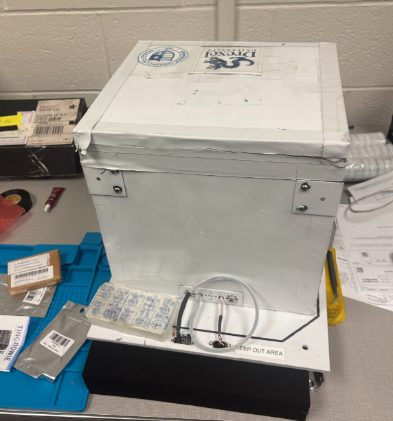
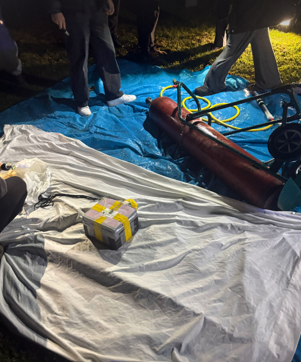
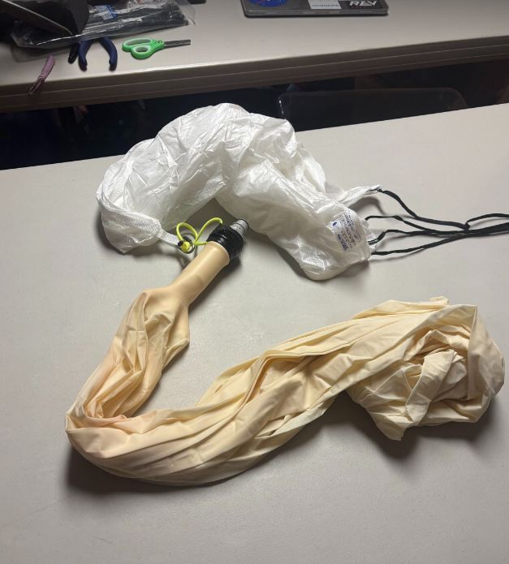
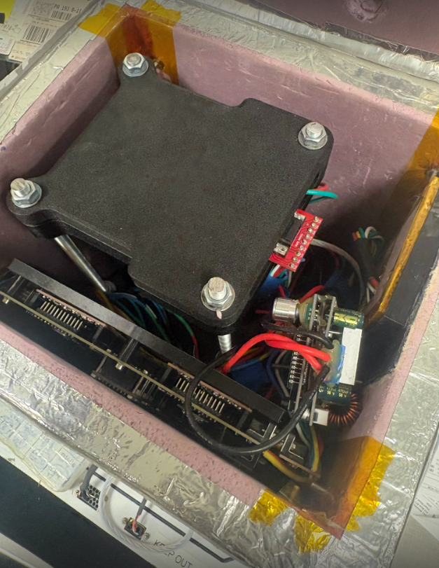
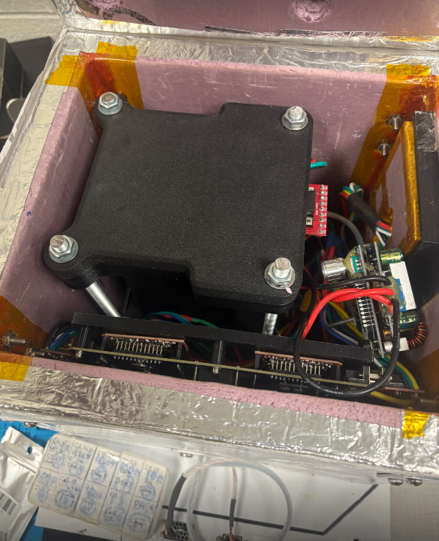

  

## Key Engineering Features
- **High-G Shock Load Design:** Engineered and analyzed (FEA) mounting assemblies to survive **10G vertical and horizontal shock forces** encountered during balloon launch and termination (parachute deployment).
- **Dense Material Integration:** Utilized **tungsten container parts** within strict weight and spatial constraints to optimize radiation/mass shielding and balanced payload weight distribution.
- **Research Collaboration:** Co-authored technical abstracts and documentation about mechanical mounting stacks for high-altitude flight feasibility and for research grants.

## Project Gallery

  <figure style="text-align: center; margin: 0;">
    
    <figcaption style="margin-top: 8px; font-size: 14px; color: #666;">
      <strong>Figure 1:</strong> SolidWorks CAD model of HASP high-altitude payload assembly.
    </figcaption>
  </figure>

  <figure style="text-align: center; margin: 0;">
    
    <figcaption style="margin-top: 8px; font-size: 14px; color: #666;">
      <strong>Figure 2:</strong> FEA stress analysis under 10G shock load conditions.
    </figcaption>
  </figure>

  <figure style="text-align: center; margin: 0;">
    
    <figcaption style="margin-top: 8px; font-size: 14px; color: #666;">
      <strong>Figure 3:</strong> Tungsten structural mounting stack cross-section.
    </figcaption>
  </figure>

  <figure style="text-align: center; margin: 0;">
    
    <figcaption style="margin-top: 8px; font-size: 14px; color: #666;">
      <strong>Figure 4:</strong> Exploded view detailing internal component alignment.
    </figcaption>
  </figure>

  <figure style="text-align: center; margin: 0;">
    
    <figcaption style="margin-top: 8px; font-size: 14px; color: #666;">
      <strong>Figure 5:</strong> Physical payload assembly and high-altitude flight setup.
    </figcaption>
  </figure>

